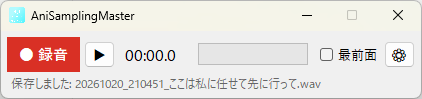
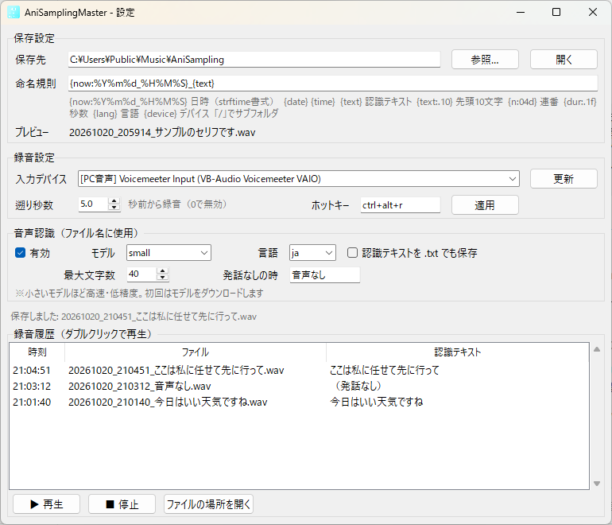

  

<h1 align="center">AniSamplingMaster</h1>

  PC で流れている音を、ボタン一つで WAV ファイルに保存するツールです。 
  <b>ボタンを押す数秒前の音から</b>録音でき、セリフが入っていれば<b>そのセリフをファイル名にして</b>保存します。

  

## できること

- **聞き逃さない「さかのぼり録音」**
  いいセリフが聞こえてから録音ボタンを押しても大丈夫です。押す 5 秒前（変更できます）からの音が保存されます。
- **セリフがそのままファイル名に**
  録音した音を自動で聞き取り、`20261020_210451_ここは私に任せて先に行って.wav` のような名前で保存します。
  インターネットに音声を送らず、パソコンの中だけで処理します。
- **小さな画面で邪魔にならない**
  画面の端に置いておけるコンパクトなウィンドウです。「最前面」にチェックを入れると、ほかのウィンドウの上に表示され続けます。
- **キーボードからも操作できる**
  `Ctrl` + `Alt` + `R` で、ほかのアプリを使っている最中でも録音の開始と停止ができます。
- **その場で聞き直せる**
  ▶ ボタンで、最後に録音したファイルをすぐに再生できます。

Windows・Mac・Linux で使えます。

## インストール

### 1. ダウンロード

このページ上部の緑色の **「Code」** ボタン → **「Download ZIP」** をクリックしてダウンロードし、ZIP ファイルを展開（解凍）します。

> [!IMPORTANT]
> 展開したフォルダは、「ドキュメント」など**今後動かさない場所**に置いてください。
> デスクトップのアイコンはこのフォルダの中身を使って起動するため、あとからフォルダを移動すると起動できなくなります。

### 2. セットアップ（最初の 1 回だけ）

**Windows の場合**

1. フォルダの中の **`setup.bat`** をダブルクリックします
   - 「セキュリティの警告」が表示されたら **「実行」** を、「Windows によって PC が保護されました」と表示されたら **「詳細情報」→「実行」** をクリックしてください
2. 「uv が見つかりません。インストールしますか」と聞かれたら **`Y`** キーを押します
3. 「セットアップが完了しました」と表示されたら、何かキーを押して画面を閉じます

**Mac / Linux の場合**

1. **「ターミナル」** アプリを開きます（Mac では「アプリケーション」→「ユーティリティ」の中、Linux ではアプリ一覧の「端末」）
2. `sh` と入力し、続けて半角スペースを 1 つ入力します
3. 展開したフォルダの中の **`setup.sh`** を、ターミナルの画面にドラッグ＆ドロップして、`Enter` キーを押します
4. 「インストールしますか」と聞かれたら **`Y`** を入力して `Enter` キーを押します

セットアップでは、動かすのに必要なもの（uv・Python・ライブラリ）を自動でダウンロードします。数分かかることがあります。
ライブラリはこのフォルダの中に、uv と Python はユーザーフォルダの中に入ります。管理者の権限は不要で、パソコン全体の設定は変更しません。

### 3. 起動

デスクトップにできた **AniSamplingMaster** のアイコンをダブルクリックすると起動します。
Windows ではスタートメニューからも起動できます。

> [!NOTE]
> **Mac の方へ**: Mac には PC の音をそのまま録音する機能がないため、追加の準備が必要です。[Mac での準備](#mac-での準備) をご覧ください。

## 使い方

### 録音する

1. 録音したい音（アニメや動画など）を再生します
2. 録りたい部分が流れたら **「● 録音」** をクリックします（またはキーボードで `Ctrl` + `Alt` + `R`）
   - ボタンを押す 5 秒前からの音が録音されます
3. 録り終わったら **「■ 停止」** をクリックします（または、もう一度 `Ctrl` + `Alt` + `R`）
4. 数秒後、セリフがファイル名になって保存されます。画面下の文字に保存したファイル名が表示されます

保存されたファイルは、最初の設定では **「ミュージック」フォルダの中の「AniSampling」フォルダ**に入ります。

> [!NOTE]
> 初めて録音したときは、聞き取り用のデータ（約 480MB）をダウンロードするため、ファイル名が付くまでに時間がかかります。2 回目からはすぐに付きます。

### メイン画面

| ボタン・表示 | 説明 |
|---|---|
| **● 録音 / ■ 停止** | 録音を始める / 止める |
| **▶ / ■** | 最後に録音したファイルを再生する / 止める |
| **00:00.0** | 録音している時間（再生中は再生している位置） |
| **緑色のバー** | 今聞こえている音の大きさ。音が流れているのにバーが動かないときは [こちら](#音が録音されないバーが動かない) |
| **最前面** | チェックを入れると、ほかのウィンドウの上に常に表示されます |
| **⚙** | 設定と録音履歴の画面を開きます |
| **画面下の文字** | 今の状態を表示します。保存したファイル名をクリックすると、そのファイルの場所を開きます |

### 設定と録音履歴（⚙ ボタン）

よく使う設定:

| 設定 | 説明 |
|---|---|
| **保存先** | 録音したファイルを保存するフォルダです。「参照…」で変更できます |
| **入力デバイス** | 録音する音の出どころです。普段音を聞いているスピーカーやヘッドホンの **`[PC音声]`** を選びます |
| **遡り秒数** | 録音ボタンを押す何秒前から録音するかです（最大 120 秒） |
| **ホットキー** | 録音の開始・停止に使うキーです。`ctrl+alt+r` や `f9` のように入力して「適用」を押します |
| **最大文字数** | ファイル名に使うセリフの最大文字数です |
| **発話なしの時** | セリフが入っていなかったときに、セリフの代わりに使う言葉です |

**録音履歴**では、起動してから録音したファイルの一覧が見られます。ダブルクリックすると再生します。

### ファイル名の付け方を変える

「命名規則」の欄で、ファイル名の形を変えられます。`{ }` で囲んだ部分が、録音した内容に置き換わります。

| 命名規則の例 | 保存されるファイル名の例 |
|---|---|
| `{now:%Y%m%d_%H%M%S}_{text}` （最初の設定） | `20261020_210451_ここは私に任せて.wav` |
| `{text}` | `ここは私に任せて.wav` |
| `{n:04d}_{text}` | `0001_ここは私に任せて.wav`（番号が 1 ずつ増えます） |
| `{now:%Y-%m-%d}/{text}` | `2026-10-20` フォルダの中に `ここは私に任せて.wav`（日付ごとにフォルダ分け） |
| `{text:.10}_{now:%H%M%S}` | `ここは私に任せて先に_210451.wav`（セリフは先頭 10 文字まで） |

使える `{ }` の一覧:

| 書き方 | 置き換わる内容 |
|---|---|
| `{text}` | 聞き取ったセリフ |
| `{now:%Y%m%d}` | 録音した日付（例: `20261020`） |
| `{now:%H%M%S}` | 録音した時刻（例: `210451`） |
| `{n:04d}` | 通し番号（例: `0001`） |
| `{dur:.1f}` | 録音の長さ（秒） |

「プレビュー」の欄に、実際のファイル名の見本が表示されます。
同じ名前のファイルがすでにある場合は、上書きせずに `_2` `_3` を付けて保存します。

### 聞き取りの精度を上げる

「音声認識」の **モデル** を大きいものにすると、聞き取りが正確になりますが、時間がかかるようになります。

| モデル | 速さ | 正確さ | ダウンロードの大きさ |
|---|---|---|---|
| tiny | とても速い | 低い | 約 75MB |
| base | 速い | やや低い | 約 145MB |
| **small**（最初の設定） | ふつう | ふつう | 約 480MB |
| medium | 遅い | 高い | 約 1.5GB |
| large-v3-turbo | 遅い | 高い | 約 1.6GB |
| large-v3 | とても遅い | とても高い | 約 3GB |

BGM や効果音が大きい場面では、セリフをうまく聞き取れないことがあります。

## Mac での準備

Mac で PC の音を録音するには、無料の仮想オーディオソフト **BlackHole** を使います。

1. [BlackHole](https://existential.audio/blackhole/) の **「BlackHole 2ch」** をダウンロードしてインストールします
2. 「アプリケーション」→「ユーティリティ」→ **「Audio MIDI 設定」** を開きます
3. 左下の **「＋」→「複数出力装置を作成」** を選び、右側で **使っているスピーカー（またはヘッドホン）** と **BlackHole 2ch** の両方にチェックを入れます
4. 「システム設定」→「サウンド」→「出力」で、作成した **「複数出力装置」** を選びます
5. AniSamplingMaster の ⚙ → 入力デバイスで **「BlackHole 2ch」** を選びます

これで、スピーカーから音を聞きながら録音できます。

- 初めて起動したときに「マイクへのアクセス」を求められたら **「許可」** してください
- キーボードでの録音操作（ホットキー）を使うには、「システム設定」→「プライバシーとセキュリティ」の **「アクセシビリティ」** と **「入力監視」** で AniSamplingMaster を許可してください

## 困ったときは

### 音が録音されない（バーが動かない）

⚙ → **入力デバイス** で、今音が出ているスピーカーやヘッドホンの **`[PC音声]`** を選んでください。
ヘッドホンを付け替えたときなどは、「更新」ボタンを押すと一覧が新しくなります。

### ファイル名が「音声なし」になる

セリフを聞き取れなかったときの名前です。BGM だけの部分や、声が小さい場合にこうなります。
モデルを大きくすると聞き取れることがあります（[聞き取りの精度を上げる](#聞き取りの精度を上げる)）。

### ホットキーが効かない

ほかのアプリが同じキーを使っている可能性があります。⚙ → ホットキー で `ctrl+shift+f9` など別の組み合わせにして「適用」を押してください。
Linux の Wayland 環境ではホットキーが使えないため、画面のボタンを使ってください。

### フォルダを移動したら起動しなくなった

移動先のフォルダで、もう一度セットアップ（`setup.bat` / `setup.sh`）を実行してください。アイコンが作り直されます。

### それでも解決しないとき

フォルダの中の **`app.log`** に動作の記録が残っています。GitHub の **Issues** で、内容と一緒に状況をお知らせください。

## アップデート・アンインストール

**アップデート**: 新しい ZIP をダウンロードして元のフォルダに上書きし、もう一度セットアップを実行します。設定はそのまま引き継がれます。

**アンインストール**:
1. デスクトップの AniSamplingMaster のアイコンを削除します（Windows ではスタートメニューからも削除します）
2. 展開したフォルダを削除します
3. 聞き取り用のデータも消す場合は、ユーザーフォルダの中の `.cache\huggingface` フォルダを削除します
4. uv も不要な場合は、[uv のアンインストール手順](https://docs.astral.sh/uv/getting-started/installation/#uninstallation) に従って削除します

## 注意事項

- 録音した音声（アニメ・動画・配信・音楽など）の著作権は、それぞれの権利者にあります。録音したデータは、私的利用など著作権法で認められた範囲で使ってください。無断での再配布や公開はしないでください。
- 配信サービスによっては、利用規約で録音を禁止している場合があります。ご利用のサービスの規約を確認してください。
- 本ツールの利用によって生じた損害について、作者は責任を負いません。
- 動作確認は Windows 11 で行っています。Mac・Linux は対応する設計になっていますが、環境によってはうまく動かない場合があります。

## 開発者向け

仕組みや設定ファイル、開発環境については [技術ドキュメント](docs/TECHNICAL.md) をご覧ください。

## ライセンス

[MIT License](LICENSE)

使用している主なライブラリ: [faster-whisper](https://github.com/SYSTRAN/faster-whisper)（MIT）、[SoundCard](https://github.com/bastibe/SoundCard)（BSD-3-Clause）、[pynput](https://github.com/moses-palmer/pynput)（LGPL-3.0）、[NumPy](https://numpy.org/)（BSD-3-Clause）
