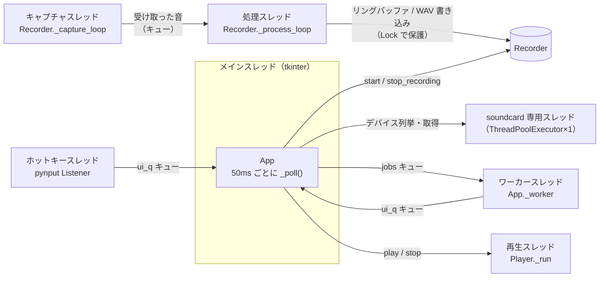
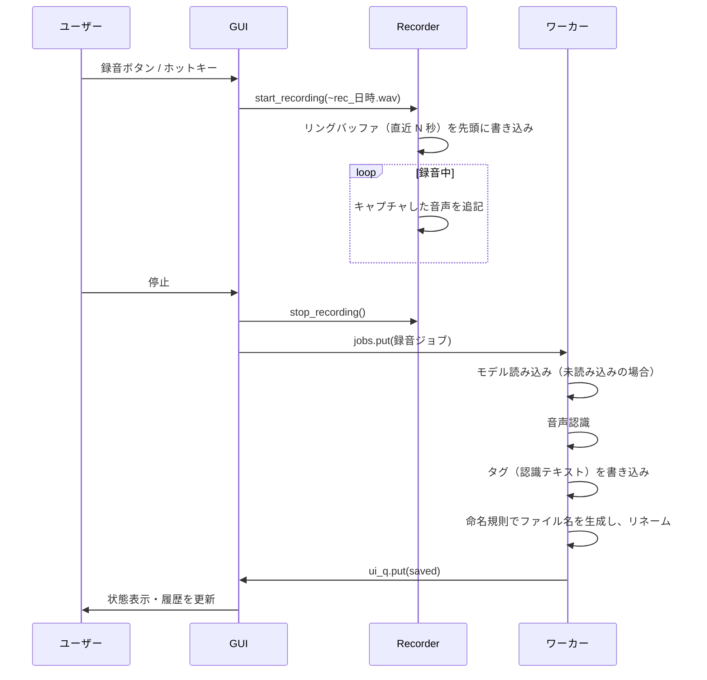

# AniSamplingMaster 技術ドキュメント

開発者・コントリビューター向けに、内部の構成と仕組みをまとめたドキュメントです。
利用方法は [README](../README.md) を参照してください。

## 目次

1. [概要](#1-概要)
2. [ディレクトリ構成](#2-ディレクトリ構成)
3. [アーキテクチャ](#3-アーキテクチャ)
4. [音声の取得](#4-音声の取得-audiopy)
5. [遡り録音（リングバッファ）](#5-遡り録音リングバッファ)
6. [音声認識](#6-音声認識-transcriberpy)
7. [ファイル名の生成](#7-ファイル名の生成-namingpy)
8. [タグの埋め込み](#8-タグの埋め込み-tagspy)
9. [簡易再生](#9-簡易再生)
10. [グローバルホットキー](#10-グローバルホットキー-hotkeypy)
11. [GUI](#11-gui-guipy)
12. [起動の仕組みとセットアップ](#12-起動の仕組みとセットアップ)
13. [設定ファイル](#13-設定ファイル-configjson)
14. [開発環境](#14-開発環境)
15. [既知の制限](#15-既知の制限)

---

## 1. 概要

PC の再生音（ループバック）を常時モニタし、録音ボタンが押された時点より前の音声も含めて WAV に保存します。
保存後に音声認識を行い、認識結果を埋め込んだ命名規則でファイルをリネームします。

| 項目 | 内容 |
|---|---|
| 言語 | Python 3.10〜3.12（`.python-version` で 3.12 を指定） |
| パッケージ管理 | [uv](https://docs.astral.sh/uv/)（`pyproject.toml` / `uv.lock`） |
| GUI | tkinter / ttk（標準ライブラリ） |
| 音声入出力 | [SoundCard](https://github.com/bastibe/SoundCard)（WASAPI / PulseAudio / CoreAudio） |
| 音声認識 | [faster-whisper](https://github.com/SYSTRAN/faster-whisper)（CTranslate2、CPU int8 が既定） |
| ホットキー | [pynput](https://github.com/moses-palmer/pynput) |
| 数値処理 | NumPy |
| 出力形式 | WAV（16bit PCM / 48kHz / 入力デバイスのチャンネル数、最大 8ch） |

## 2. ディレクトリ構成

```
AniSamplingMaster/
├── main.py                 エントリポイント（ログ出力先の切り替え、起動失敗時のダイアログ）
├── launch.pyw              Windows のデスクトップアイコン用の起動スクリプト（コンソールなし）
├── setup.bat / setup.sh    利用者向けセットアップ（uv 導入 → uv sync → アイコン作成）
├── run.bat / run.sh        開発用の起動スクリプト（ターミナルにログを表示）
├── anisampler/
│   ├── gui.py              画面・状態管理・バックグラウンド処理の取りまとめ
│   ├── audio.py            録音（Recorder）・再生（Player）・WAV 読み込み
│   ├── transcriber.py      faster-whisper のラッパーと 16kHz への変換
│   ├── naming.py           命名規則テンプレートの展開・ファイル名の無害化
│   ├── tags.py             WAV へのタグ（RIFF INFO / ID3）の書き込み
│   ├── hotkey.py           グローバルホットキー
│   ├── shortcut.py         OS ごとの起動アイコン作成・削除
│   └── config.py           config.json の読み書きと既定値
├── assets/                 アイコン（icon.png / icon.ico / icon.icns）
└── docs/                   ドキュメントとスクリーンショット
```

実行時に生成されるファイル（いずれも `.gitignore` 済み）:

| ファイル | 内容 |
|---|---|
| `.venv/` | uv が作成する仮想環境 |
| `config.json` | ユーザー設定 |
| `app.log` | アイコンから起動したときの標準出力・標準エラー（起動ごとに上書き） |

## 3. アーキテクチャ

### スレッド構成

GUI のメインスレッドをブロックしないよう、処理ごとにスレッドを分けています。



| スレッド | 役割 | 備考 |
|---|---|---|
| メイン | tkinter のイベントループ。`_poll()` で他スレッドの状態を画面に反映 | tkinter は他スレッドから触らない |
| soundcard 専用 | soundcard の import とデバイス列挙・取得 | Windows の COM 初期化を tkinter と分離するため（後述） |
| キャプチャ | デバイスから音を受け取り、キューに入れるだけ | daemon。受け取りを止めないため他の処理をしない |
| 処理 | 16bit への変換、レベル計測、リングバッファ更新、WAV への書き込み | daemon。ディスクが遅くても受け取りに影響しない |
| ワーカー | 音声認識モデルの読み込み、認識、リネームを順番に処理 | daemon、`jobs` キューで受け取る |
| 再生 | WAV を 50ms 単位でスピーカーへ書き込む | daemon |
| ホットキー | キー入力を監視し、押されたら `ui_q` に通知 | pynput が管理 |

スレッド間の通信は `queue.Queue` で行います。

- **`jobs`**（GUI → ワーカー）: `{"type": "preload", "model": ...}`（モデルの事前読み込み）または録音ジョブ（一時ファイルのパス、録音開始時刻、録音停止時点の設定のスナップショットなど）
- **`ui_q`**（ワーカー / ホットキー → GUI）: `("status", 文字列)` / `("saved", 行ID, パス, テキスト, エラー)` / `("hotkey",)` / `("worker_done",)`

### 録音から保存までの流れ



## 4. 音声の取得（audio.py）

### OS ごとのバックエンド

SoundCard の `all_microphones(include_loopback=True)` で、通常の入力デバイスとループバック（再生音）デバイスをまとめて取得します。画面にはループバックを `[PC音声]`、それ以外を `[入力]` として表示し、ループバックを先に並べます。

| OS | バックエンド | PC 音声の取得方法 |
|---|---|---|
| Windows | WASAPI（Media Foundation） | スピーカーのループバック |
| Linux | PulseAudio / PipeWire（pipewire-pulse） | 出力デバイスのモニターソース（`Monitor of …`） |
| macOS | CoreAudio | OS にループバック機能がないため、BlackHole などの仮想デバイスを入力として選ぶ |

既定のデバイスは「既定のスピーカーのループバック」で、取得できない場合は既定のマイクを使います（`Recorder.default_device_id()`）。

### Windows の COM 初期化

SoundCard は Windows では import した時点で、そのスレッドを COM の MTA として初期化します。
tkinter のメインスレッドで import すると、ファイル選択ダイアログなど STA を前提とする機能と衝突するおそれがあります。
そのため `Recorder` は 1 スレッドだけの `ThreadPoolExecutor` で soundcard を import し、デバイスの列挙や取得もこのスレッドで行います。
このスレッドが生き続けることでプロセス内に MTA が維持され、キャプチャスレッドや再生スレッドからも WASAPI を利用できます。

### キャプチャ

音の取りこぼしや途切れを防ぐため、次の構成にしています。

- **受け取りと処理の分離**: キャプチャスレッドはデバイスから受け取った音をキューに入れるだけにし、変換・リングバッファ更新・ファイル書き込みは処理スレッドで行います。ディスクへの書き込みが遅れても、デバイスからの受け取りは止まりません
- **WASAPI のバッファ**: SoundCard は `recorder()` の `blocksize` をそのまま WASAPI のバッファ長として使います。1024 フレーム（約 21ms）では、受け取り側が一瞬止まっただけでバッファがあふれて音が欠けるため、Windows では 0.5 秒（`DEVICE_BUFFER_SEC`）にしています。読み取りは小さい単位で行うので、遅延は増えません
- **独自の読み取り処理（Windows）**: SoundCard の `record()` は「データなし」を確認してから待つ間にスレッドが止まると、実際には音が届いていても確認し直さずに無音を差し込みます（音の途切れになる）。`Recorder._read_wasapi()` では、先に時刻を取ってからデータの有無を確認し、データがあるときだけ `_record_chunk()` を呼びます。前回の読み取りから 0.1 秒（`IDLE_FILL_SEC`）以上デバイスが何も出していないとき（何も再生されていないとき）だけ、その時間ぶんを無音で埋めて時間軸を保ちます
- **変換**: 受け取った float32 の配列は `[-1, 1]` にクリップして 16bit 整数（`<i2`）に変換します
- **レベルメーター**: ブロックごとのピーク値を `Recorder.peak` に保持し、GUI が 50ms ごとに読み出して 0 に戻します

macOS・Linux では SoundCard の `record(numframes=1024)` をそのまま使います。

### 取りこぼしの検出

WASAPI はバッファがあふれて音を取りこぼすと、`AUDCLNT_BUFFERFLAGS_DATA_DISCONTINUITY` を立て、SoundCard が `data discontinuity` 警告を出します。
この警告は無音から音が鳴り始めたときにも出るため、`warnings.showwarning` を差し替え、直前のブロックが無音でない場合だけ数えます（`Recorder.glitches` / `rec_glitches`）。
録音中に取りこぼしがあった場合は、保存時の状態表示に回数を出します。

### 検証結果

録音中に GIL を握ったまま止まる処理（約 0.05 秒 / 約 0.35 秒）を繰り返し挟み、440Hz の正弦波をループバック録音して、波形の不連続点を数えました（Windows 11、Voicemeeter VAIO）。

| 構成 | 負荷 | 不連続点 | 録音の長さ / 経過時間 |
|---|---|---|---|
| 旧（バッファ 21ms、SoundCard の `record()`） | 0.05 秒 | 47 | 5.53 秒 / 約 5.2 秒（音が欠ける） |
| バッファ 0.5 秒、SoundCard の `record()` | 0.05 秒 | 30 | 5.95 秒 / 約 5.2 秒（無音が差し込まれる） |
| 現在（バッファ 0.5 秒、独自の読み取り） | 0.05 秒 | 0 | 5.20 秒 / 5.20 秒 |
| 現在 | 0.35 秒 | 0 | 5.10 秒 / 5.09 秒 |
| 現在（何も再生していない状態） | 0.05 秒 | 0 | 5.20 秒 / 5.19 秒（無音で正しく埋まる） |

## 5. 遡り録音（リングバッファ）

`Recorder` は、キャプチャしたブロック（bytes）を `collections.deque` に追加し、合計フレーム数が「遡り秒数 × サンプルレート」を超えた分を先頭から捨てます。

```
_handle(block):
    ring.append(pcm); ring_frames += n
    while ring_frames - len(ring[0]) >= preroll_frames:   # 先頭を捨てても足りる間
        ring.popleft()
    if 録音中: wav.writeframes(pcm)
```

- `start_recording()` はロック内で WAV を開き、`b"".join(ring)` の末尾から遡り秒数ぶんを書き込んでから録音状態にします。ロックにより、遡り部分とその後の追記の間で音が欠けたり重複したりしません
- 録音中もリングバッファの更新は続けます
- 遡り秒数を増やした場合、バッファが新しい秒数ぶん溜まるまでは、溜まっている分だけが遡り部分になります
- 録音中のファイル名は `~rec_YYYYmmdd_HHMMSS_ffffff.wav` です。音声認識とリネームが終わると最終的な名前になります
- 認識が終わる前にアプリを終了した場合は、認識をスキップして「発話なしの時」の文字列で命名します

## 6. 音声認識（transcriber.py）

### 処理

1. `load_wav_16k()` で WAV を読み込み、モノラルの float32 / 16kHz に変換します
   - チャンネルは平均してモノラルにします
   - ダウンサンプリングの前に、窓付き sinc の FIR ローパス（129 タップ、カットオフはナイキスト周波数の 90%、Hamming 窓）をかけてエイリアシングを防ぎます
   - その後 `numpy.interp` で 16kHz に線形補間します
2. faster-whisper の `WhisperModel.transcribe()` に配列を渡します

| パラメータ | 値 | 理由 |
|---|---|---|
| `vad_filter` | `True` | Silero VAD で無音や BGM のみの区間を除外し、幻聴テキストを減らす |
| `beam_size` | `5` | faster-whisper の標準的な値 |
| `condition_on_previous_text` | `False` | 短いクリップで前のセグメントに引きずられた繰り返しを防ぐ |
| `language` | 設定値（`auto` のときは `None`） | 日本語を固定すると誤判定が減る |

3. Whisper 標準の無音判定（`no_speech_prob > 0.6` かつ `avg_logprob < -1.0`）に当てはまるセグメントを捨て、残りのテキストを連結します

### PyAV を使わない理由

faster-whisper はファイルパスを渡すと PyAV でデコードしますが、PyAV 19 で `av.open()` の `metadata_errors` 引数が削除され、faster-whisper 1.2.1 の `decode_audio()` が `TypeError` で失敗します。
本ツールの録音は常に 16bit PCM の WAV なので、標準ライブラリの `wave` と NumPy で読み込み、配列で渡すことで依存バージョンの影響を受けないようにしています。

### モデル

- 起動時に、音声認識が有効ならワーカーへ `preload` ジョブを送り、バックグラウンドでモデルを読み込みます
- モデルを切り替えると、その場で読み込み直します
- モデルは初回に Hugging Face Hub（`Systran/faster-whisper-*`）からダウンロードされ、`~/.cache/huggingface/hub` にキャッシュされます
- 既定は CPU・int8 です。NVIDIA GPU を使う場合は `config.json` の `whisper_device` を `"cuda"`、`whisper_compute_type` を `"float16"` にします（CUDA 12 と cuDNN 9 が必要）

## 7. ファイル名の生成（naming.py）

命名規則は Python の `str.format` 書式です。`build_filename()` に以下の値を渡して展開します。

| キー | 型 | 内容 |
|---|---|---|
| `now` | `datetime` | 録音開始日時。`{now:%Y%m%d}` のように strftime 書式を指定できる |
| `date` / `time` | `str` | `YYYYmmdd` / `HHMMSS` |
| `text` | `str` | 認識テキスト（無害化・最大文字数で切り詰め済み）。空の場合は「発話なしの時」の文字列 |
| `n` | `int` | 連番（`config.json` の `counter`。録音を停止するたびに 1 増える） |
| `dur` | `float` | 録音秒数（遡り部分を含む） |
| `lang` | `str` | 認識された言語コード |
| `device` | `str` | 録音デバイス名 |

### 無害化

- Windows でファイル名に使えない `\ / : * ? " < > |` は、全角文字（`＼ ／ ： ＊ ？ ” ＜ ＞ ｜`）に置き換えます
- 制御文字は削除し、連続する空白は 1 つにまとめます
- `text` と `device` は**展開前に**無害化します。そのため、セリフに含まれる `/` がフォルダの区切りとして扱われることはありません
- 展開後の文字列を `/` と `\` で分割し、各要素の前後の ` ._-` を取り除きます。空の要素や `.` `..` は捨てます（保存先フォルダの外に出ない）
- `CON` `PRN` `AUX` `NUL` `COM1〜9` `LPT1〜9` は先頭に `_` を付けます
- ファイル名部分は 150 文字で切り詰めます（Windows のパス長制限への配慮）
- 結果が空になった場合は `YYYYmmdd_HHMMSS` を使います

### その他

- 同名のファイルが存在する場合は `_2`、`_3` … を付けます（`unique_path()`）
- 命名規則が不正な場合は、録音開始時にエラーを表示して録音しません。リネーム時に不正だった場合は既定の命名規則で保存します
- 認識テキストを `.txt` でも保存する設定にすると、WAV と同じ名前のテキストファイルを書き出します

## 8. タグの埋め込み（tags.py）

DAW や素材管理ソフトで認識テキストを検索できるよう、リネームの直前に WAV ファイルへタグを書き込みます（設定の `embed_tags`）。
ソフトによって読むタグが異なるため、2 種類を同時に書き込みます。

| 形式 | チャンク | 書き込むフィールド | 文字コード | 位置 |
|---|---|---|---|---|
| RIFF INFO | `LIST`（`INFO`） | `INAM`（タイトル）、`ICMT`（コメント）、`ICRD`（日付）、`ISFT`（ソフト名） | Windows: システムの文字コード（日本語版は CP932）<br>その他: UTF-8 | `data` の後ろ |
| ID3v2.3 | `id3 ` | `TIT2`（タイトル）、`COMM`（コメント、言語は認識言語から `jpn` など）、`TYER`（年）、`TSSE`（ソフト名） | UTF-16（BOM 付き） | ファイル末尾 |

タイトルとコメントには、認識テキストを切り詰めずにそのまま入れます（ファイル名用の最大文字数は適用しません）。発話がなかった場合は、タイトルとコメントを書き込みません。

### 形式と配置を決めた根拠

Windows 11 のエクスプローラー（Windows のプロパティシステム）で読み取りを確認した結果です。

| 書き込み方 | エクスプローラーでの表示 |
|---|---|
| INFO を `fmt` と `data` の間に置く | 表示されない（文字コードを問わず） |
| INFO を `data` の後ろ、または `fmt` の前に置く | 表示される |
| INFO を UTF-8 で書く | 文字化けする（CP932 として解釈される） |
| INFO を CP932 で書く | 正しく表示される |
| ID3（v2.3 / v2.4、`id3 ` / `ID3 `、配置を問わず） | 表示されない |

ID3 は Windows では読まれませんが、文字コードの曖昧さがない形式で、ID3 に対応した DAW やタグ編集ソフト向けに書き込んでいます。
システムの文字コードで表せない文字（絵文字など）は、INFO では `?` に置き換わります。ID3 には元の文字のまま入ります。

### 書き込みの手順

1. ファイル全体を読み込み、チャンクに分解する（奇数長のチャンクは 1 バイトのパディングを考慮）
2. 既存の `LIST`（`INFO`）と `id3 ` / `ID3 ` チャンクを取り除く（何度書き込んでもタグが重複しない）
3. 残りのチャンク（`fmt ` と `data` など）の後ろに INFO と ID3 を追加し、RIFF ヘッダーのサイズを書き直す
4. 一時ファイル（`.tagtmp`）に書き出してから `os.replace` で置き換える

タグの書き込みに失敗した場合は、タグなしで録音ファイルを保存し、状態表示に警告を出します。

## 9. 簡易再生

`audio.Player` が WAV をメモリに読み込み、既定のスピーカーで再生します。

- 出力は 2ch（スピーカーがモノラルなら 1ch）にそろえます。モノラルの録音は左右に複製し、3ch 以上は先頭の 2ch を使います
- Windows では出力バッファを 0.5 秒（`PLAYER_BUFFER_SEC`）にし、独自の書き込み処理（`Player._play_wasapi()`）を使います。SoundCard の `play()` は、渡したデータより出力バッファの空きが大きいと空き全体を書き込んだことにし、足りない分を無音で鳴らしてしまうためです。空きとデータの小さい方だけを書き込み、最後はバッファが空になるまで待ってから閉じます（最後の音が切れない）
- 5ms ごとに停止要求を確認します。停止するとバッファに残った音は破棄されるため、バッファを大きくしても停止は遅れません
- 再生位置は「書き込んだフレーム数 − まだ鳴っていないフレーム数（`currentpadding`）」から計算します
- GUI は `_poll()` で再生位置を経過時間の欄に表示し、再生の終了を検出してボタンを ▶ に戻します

録音との競合を避けるため、次のように制御しています。

- 録音中は再生ボタンを無効にする
- 再生中に録音を始めた場合は再生を止める
- 録音デバイスがループバックの場合、再生終了時にリングバッファを破棄する（`Recorder.clear_ring()`）。再生した音が次の録音の遡り部分に入らないようにするため

## 10. グローバルホットキー（hotkey.py）

- 設定の `ctrl+alt+r` 形式を pynput の `<ctrl>+<alt>+r` 形式に変換し、`keyboard.GlobalHotKeys` で登録します
- 修飾キー: `ctrl` / `alt`（`option`）/ `shift` / `win`（`cmd`, `super`）
- キー: 英数字 1 文字、`f1`〜`f20`、`space` `enter` `tab` `esc` `pause` `insert` `delete` `home` `end` `pageup` `pagedown` `scrolllock` と矢印キー
- コールバックはホットキースレッドで呼ばれるため、`ui_q` に `("hotkey",)` を入れるだけにし、録音の切り替えはメインスレッドで行います
- 登録できない環境（X サーバーがない、権限不足など）では、状態表示にエラーを出して画面のボタンだけで動作します

| OS | 制限 |
|---|---|
| macOS | 「アクセシビリティ」と「入力監視」の許可が必要 |
| Linux | X11 のみ。Wayland ではグローバルなキー監視ができない |

## 11. GUI（gui.py）

### 画面構成

- **メインウィンドウ**（`_build_compact`）: 録音ボタン、再生ボタン、経過時間、レベルメーター、「最前面」、⚙、状態表示。サイズは固定です
  - 状態表示のラベルは `width=1` と `fill="x"` を指定し、長い文字列でもウィンドウが広がらずに切り詰められるようにしています
- **設定ウィンドウ**（`_build_settings`）: `Toplevel`。閉じても破棄せず `withdraw()` で隠すため、入力内容は保持されます。閉じたときに設定を保存します

### その他の実装

- **レベルメーター**: ピーク値を dBFS に変換し、-60〜0dB を 0〜100% に割り当てます。前回の値に 0.85 を掛けたものとの大きい方を表示し、針がゆっくり下がるようにしています
- **ウィンドウ位置**: 終了時に `+x+y` を `window_pos` に保存し、起動時に復元します。Windows では `GetSystemMetrics`（`SM_XVIRTUALSCREEN` など）で全モニターを合わせた領域を取得し、その外になる場合は復元しません
- **タスクバーのアイコン**: Windows では `SetCurrentProcessExplicitAppUserModelID` を呼び、Python ではなく本アプリのアイコンがタスクバーに出るようにしています
- **高 DPI**: Windows では `SetProcessDpiAwareness(1)` を呼び、文字のにじみを防いでいます
- **WM_CLASS**: `tk.Tk(className="AniSamplingMaster")` とし、Linux の `.desktop` の `StartupWMClass` と対応させています
- **フォント**: Windows は Yu Gothic UI、macOS は Hiragino Sans、それ以外は Noto Sans CJK JP

### 終了処理

1. 録音中なら停止し、録音ジョブを投入します
2. ウィンドウ位置を含む設定を保存します
3. `closing = True` にして、ワーカーに終了の合図（`None`）を送ります。以降の録音ジョブは認識をスキップしてリネームだけ行います
4. ワーカーが `worker_done` を返したら、ホットキー・再生・録音を止めてウィンドウを破棄します

## 12. 起動の仕組みとセットアップ

### セットアップ（setup.bat / setup.sh）

1. `uv` が PATH にあるか確認し、なければ `~/.local/bin/uv` を探す
2. どちらにもなければ、利用者に確認したうえで公式のインストーラーを実行する
3. `uv sync` で `.venv` に依存ライブラリを入れる（Python が無ければ uv が自動でダウンロード）
4. `uv run python -m anisampler.shortcut` で起動アイコンを作成する

`setup.bat` は日本語のメッセージを表示するため、UTF-8（CRLF）で保存し、先頭で `chcp 65001` を実行しています。改行コードは `.gitattributes` で固定しています（`*.bat` は CRLF、`*.sh` は LF）。

### 起動アイコン（shortcut.py）

| OS | 作成場所 | 起動コマンド |
|---|---|---|
| Windows | デスクトップ、スタートメニュー（`.lnk`） | `<Python 本体>\pythonw.exe launch.pyw` |
| macOS | `~/Desktop/AniSamplingMaster.app` | `.venv/bin/python main.py --log` |
| Linux | `~/.local/share/applications/`、デスクトップ（`.desktop`） | `.venv/bin/python main.py --log` |

- Windows のデスクトップの場所は `[Environment]::GetFolderPath('Desktop')` で取得します（OneDrive でリダイレクトされている場合に対応）。`.lnk` は PowerShell の `WScript.Shell` で作成し、パスは環境変数で渡して日本語や空白を含むパスが崩れないようにしています
- macOS の `.app` は、シェルスクリプトを実行ファイルとする最小構成のバンドルです。`Info.plist` に `NSMicrophoneUsageDescription` を含めています
- Linux では GNOME で「信頼されていない起動ファイル」扱いにならないよう、`gio set … metadata::trusted true` を実行します（失敗しても無視）
- `uv run python -m anisampler.shortcut --remove` でアイコンを削除できます

### launch.pyw が必要な理由

uv が作る `.venv\Scripts\pythonw.exe` は、`pyvenv.cfg` の Python を起動する中継用の実行ファイルです。
uv 0.7.14 で確認したところ、この中継先がコンソール版の `python.exe` になっていて、起動するとコンソールが割り当てられます。既定のターミナルが Windows Terminal の環境では、タブが開いたままになります。

そこで Windows のアイコンは、uv が管理する **Python 本体の `pythonw.exe`**（`sys.base_prefix`）で `launch.pyw` を実行します。
`launch.pyw` は `site.addsitedir()` で `.venv` の site-packages を読み込み、`--log` を付けて `main.py` を実行します。この方法では、起動するプロセスは `pythonw.exe` の 1 つだけで、コンソールは作られません。

| 起動方法 | 起動するプロセス | コンソール |
|---|---|---|
| `.venv\Scripts\pythonw.exe main.py` | pythonw → conhost → python | ターミナルに表示される |
| `uvw run main.py` | uvw → uv → conhost → python ×2 | 非表示だが存在する |
| `pythonw.exe launch.pyw`（採用） | pythonw のみ | なし |

### ログ（main.py）

`--log` が指定された場合、または `sys.stdout` / `sys.stderr` が `None`（pythonw で起動）の場合は、出力を `app.log` に書き出します。
pythonw では `sys.stderr` が `None` になり、Hugging Face Hub のダウンロード進捗バー（tqdm）などが書き込みに失敗するためです。
起動時に例外が発生した場合は、トレースバックをログに出力し、ダイアログでも表示します。

## 13. 設定ファイル（config.json）

プロジェクト直下に保存されます。存在しないキーは `config.DEFAULTS` の値で補われます。

| キー | 既定値 | 内容 |
|---|---|---|
| `out_dir` | `~/Music/AniSampling` | 保存先フォルダ |
| `device_name` | `""` | 入力デバイスの表示名（空なら既定のループバック） |
| `preroll_sec` | `5.0` | 遡り秒数（0〜120） |
| `template` | `{now:%Y%m%d_%H%M%S}_{text}` | 命名規則 |
| `recognize` | `true` | 音声認識の有効・無効 |
| `model` | `small` | Whisper モデル（`tiny` `base` `small` `medium` `large-v3-turbo` `large-v3`） |
| `language` | `ja` | 認識言語（`ja` `auto` `en` `zh` `ko`） |
| `max_text_len` | `40` | ファイル名に使う認識テキストの最大文字数（0 で無制限） |
| `fallback_text` | `音声なし` | 発話がなかったときの `{text}` |
| `save_txt` | `false` | 認識テキストを `.txt` でも保存する |
| `embed_tags` | `true` | 認識テキストを WAV のタグ（タイトル・コメント）に書き込む |
| `hotkey` | `ctrl+alt+r` | グローバルホットキー（空で無効） |
| `counter` | `1` | 次の連番 `{n}` |
| `topmost` | `false` | 最前面に表示する |
| `window_pos` | `""` | メインウィンドウの位置（`+x+y`） |
| `whisper_device` | `cpu` | CTranslate2 のデバイス（`cpu` / `cuda`）。画面からは変更不可 |
| `whisper_compute_type` | `int8` | CTranslate2 の計算精度（`int8` / `float16` など）。画面からは変更不可 |

## 14. 開発環境

```sh
uv sync          # 依存ライブラリのインストール
uv run main.py   # ターミナルにログを表示して起動（run.bat / run.sh と同じ）
```

- 依存ライブラリの追加は `uv add <パッケージ>` で行い、`uv.lock` もコミットします
- 自動テストはありません。変更したときは、少なくとも以下を手動で確認してください
  - 録音して、遡り秒数ぶん前の音から保存されること
  - セリフ入りの音声で、認識結果がファイル名になること（Windows では音声合成の `System.Speech` で日本語の WAV を作ると確認しやすい）
  - 再生・停止と、録音中に再生できないこと
  - デスクトップアイコンから起動して、ターミナルが開かないこと
- アイコン画像（`assets/`）を差し替える場合は、`icon.png`（512px、ウィンドウ・Linux 用）、`icon.ico`（16〜256px、Windows 用）、`icon.icns`（macOS 用）の 3 つを用意し、`setup` を実行し直してアイコンを作り直します

## 15. 既知の制限

- 動作確認は Windows 11 でのみ行っています。macOS・Linux 向けのコード（`.app` / `.desktop` の作成、CoreAudio / PulseAudio での録音）は実機で検証していません
- macOS で PC 音声を録るには、BlackHole などの仮想オーディオデバイスが必要です
- Linux の Wayland 環境では、グローバルホットキーが使えません
- ループバックで録音しているデバイスと同じスピーカーで再生すると、再生音も録音されます（録音中は再生不可にして回避しています）
- 起動アイコンは展開したフォルダの絶対パスを参照するため、フォルダを移動したら `setup` を実行し直す必要があります
- 録音履歴は保存されず、アプリを終了すると消えます
- 録音は 16bit / 48kHz 固定です
- Windows の録音・再生では、SoundCard の内部メソッド（`_capture_available_frames` / `_record_chunk` / `_render_buffer` など）を使っています。SoundCard を更新するときは、これらが変わっていないか確認してください（`uv.lock` でバージョンを固定しています）
- INFO タグの文字コードは、書き込んだ OS に合わせています。Windows で作ったファイルを Mac・Linux のソフトで開くと、INFO のタイトルが文字化けする場合があります（ID3 は文字化けしません）
